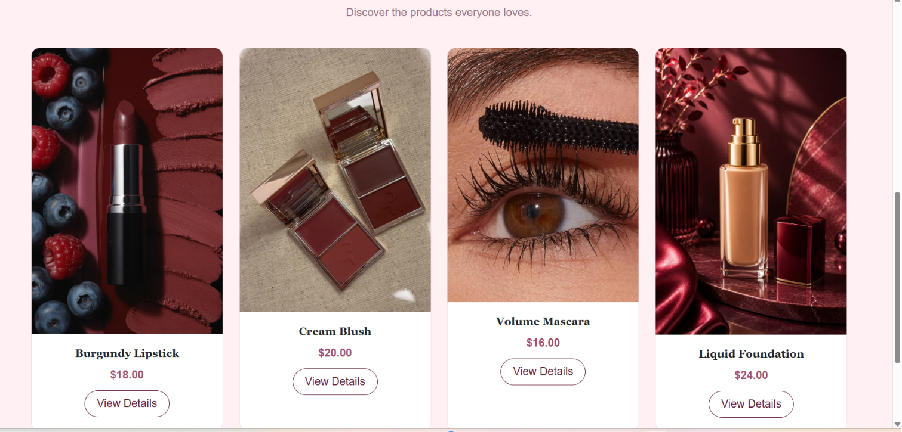
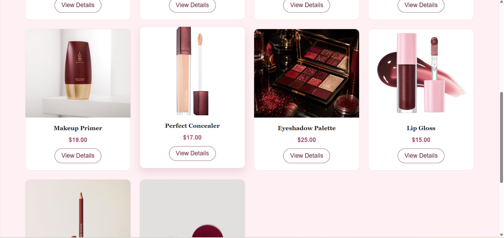
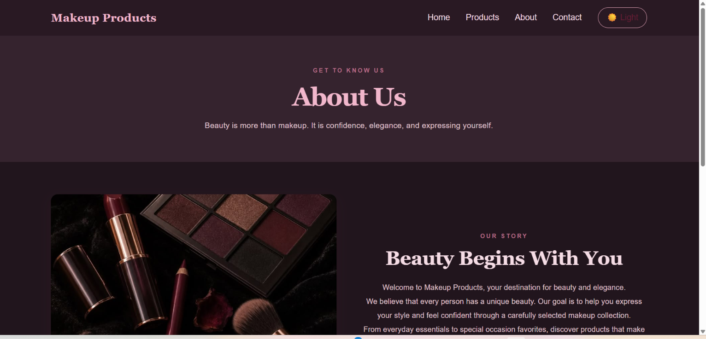
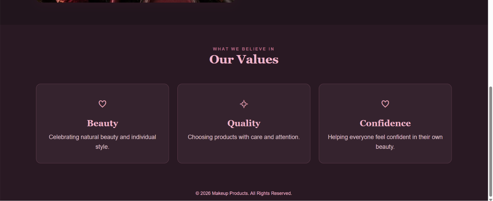
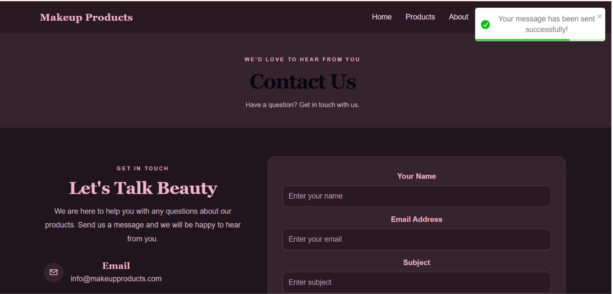
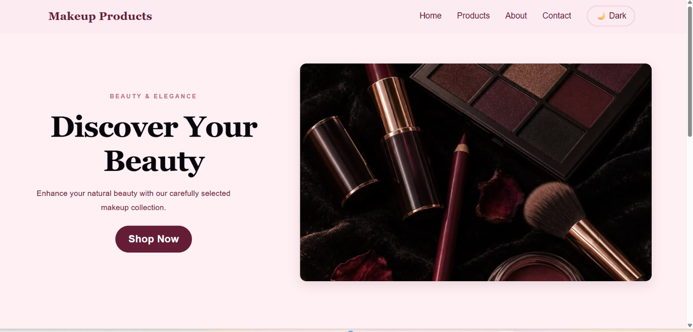

# Makeup Products Store 💄

## 1. Project Description

Makeup Products is a responsive makeup e-commerce frontend website developed using React.js.

The website allows users to explore different makeup products, view product details, and interact with a contact form.

The design uses an elegant combination of Burgundy, Baby Pink, and Cream colors to create a modern beauty shopping experience.

## 2. Website Pages

The website consists of five main pages:

- **Home Page:** Introduces the website and displays featured products and best sellers.
- **About Page:** Provides information about the website and its values.
- **Products Page:** Displays the complete makeup product collection.
- **Product Details Page:** Shows individual product information, descriptions, prices, and features using dynamic routing.
- **Contact Page:** Provides a contact form for users to send messages.

## 3. Main Features

- Responsive design for desktop and mobile devices.
- Light Mode and Dark Mode.
- Dynamic product details using React Router.
- Product cards with images, names, and prices.
- Add to Cart button with success notifications.
- Contact form with input validation.
- Toast notifications using React Toastify.
- Easy navigation between pages.

## 4. Technologies Used

- React.js
- JavaScript
- HTML5
- CSS3
- Bootstrap 5
- React Router DOM
- React Toastify
- Vite
- Git and GitHub

## 5. Installation and Setup

Follow these steps to run the project locally:

### Step 1: Clone the Repository

```bash
git clone https://github.com/52330231-glitch/MakeupProducts.git
```

### Step 2: Navigate to the Project Folder

```bash
cd MakeupProducts
```

### Step 3: Install Dependencies

```bash
npm install
```

### Step 4: Start the Development Server

```bash
npm run dev
```

### Step 5: Open the Website

Open the local URL displayed in the terminal in your browser.

## 6. Project Screenshots

The following screenshots show the user interface and design of the Makeup Products website.

### Screenshot 1



### Screenshot 2



### Screenshot 3



### Screenshot 4



### Screenshot 5



### Project Overview



## 7. GitHub Repository

[Makeup Products - GitHub Repository](https://github.com/52330231-glitch/MakeupProducts)

## 8. Notes

This project is a frontend implementation. The contact form displays a success notification but does not send actual emails. The Add to Cart button currently displays a confirmation notification and does not use a persistent shopping cart.

---

**Course:** CSCI426 - Advanced Web Programming

**Project:** Phase 1

**Developed by:** Shymaa Abdelrahman
